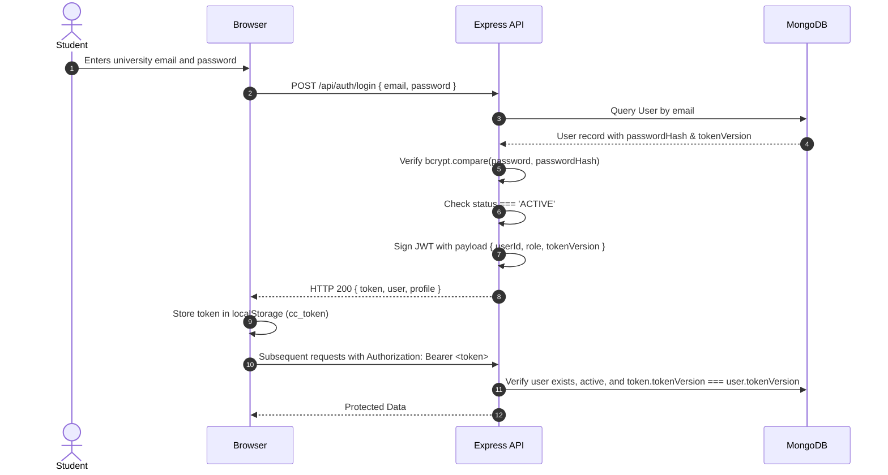

# Authentication & Role-Based Access Control (RBAC)

## 1. Authentication Architecture

CampusConnect uses stateless JSON Web Token (JWT) authentication coupled with database-backed session invalidation (`tokenVersion`).



---

## 2. Institutional Registration Guard (Decision Table 2)

To satisfy **Decision Table 2 Rule 1**, self-registration is restricted strictly to permitted university email domains.

1. **Email Domain Extraction:** When a registration request arrives at `POST /api/auth/register`, the backend parses the domain suffix after the `@` symbol.
2. **Dynamic Configuration Lookup:** The domain is checked against the `allowedEmailDomains` array stored in the `SystemConfiguration` collection:
   ```typescript
   export const isAllowedEmailDomain = async (email: string): Promise<boolean> => {
     const domain = email.split('@')[1]?.toLowerCase();
     if (!domain) return false;
     
     const allowedDomains = await getAllowedEmailDomains(); // Defaults to ['silicon.ac.in']
     return allowedDomains.includes(domain);
   };
   ```
3. **Rejection Response:** If a user attempts to register with a non-university domain (e.g. `user@gmail.com`), the server rejects the request with **HTTP 400 Bad Request**:
   `"Invalid email domain: Self-registration is restricted to authorized Silicon University email domains (e.g., @silicon.ac.in)."`
4. **Duplicate Email Handling (Rule 5):** If the email already exists in the `users` collection, the server returns **HTTP 409 Conflict**:
   `"An account with this university email address already exists. Please sign in."`

---

## 3. Immediate Session Revocation Pattern (Decision Table 8)

Traditional stateless JWT implementations suffer from a significant vulnerability: after an administrator suspends a malicious or policy-violating user, the user remains authenticated until the token expires.

CampusConnect overcomes this with **Active Token Versioning**:

1. In `User.ts`:
   ```typescript
   tokenVersion: { type: Number, default: 0 }
   ```
2. When minting a token in `utils/jwt.ts`:
   ```typescript
   export const generateToken = (payload: { userId: string; role: string; tokenVersion: number }): string => {
     return jwt.sign(payload, config.jwtSecret, { expiresIn: config.jwtExpiresIn });
   };
   ```
3. In `middleware/auth.ts`:
   ```typescript
   // Verify tokenVersion matches current user state
   if (decoded.tokenVersion !== user.tokenVersion) {
     res.status(401).json({
       success: false,
       message: 'Authentication session has been revoked. Please sign in again.',
     });
     return;
   }
   ```
4. In `controllers/admin.controller.ts` (`suspendStudent`):
   ```typescript
   student.status = 'SUSPENDED';
   student.tokenVersion = (student.tokenVersion || 0) + 1; // Immediately invalidates existing tokens
   await student.save();
   await UserSession.deleteMany({ userId: id });
   ```

Any in-flight or subsequent request bearing the old token is instantly rejected with HTTP 401 or HTTP 403.

---

## 4. Role-Based Access Control (RBAC) Middleware

There are two primary system roles:
- `STUDENT`: Authorized for student modules, creating projects, posting Q&A, booking events, and submitting claims.
- `ADMIN`: Authorized for administrative console, moderation, suspensions, broadcasts, and configuration.

### Express RBAC Middleware (`middleware/rbac.ts`)
```typescript
export const authorize = (...allowedRoles: UserRole[]) => {
  return (req: AuthenticatedRequest, res: Response, next: NextFunction): void => {
    if (!req.user) {
      res.status(401).json({ success: false, message: 'Unauthenticated.' });
      return;
    }

    if (!allowedRoles.includes(req.user.role)) {
      res.status(403).json({
        success: false,
        message: 'Forbidden: You do not have permission to perform this action.',
      });
      return;
    }

    next();
  };
};
```

### Client-Side Route Protection (`ProtectedRoute.tsx`)
On the React frontend, `<ProtectedRoute requiredRole="ADMIN" />` inspects the authenticated user state before rendering administrative layouts. If an unauthorized student accesses `/admin/*`, the route guard redirects them to `/unauthorized`. If an account is suspended, they are redirected to `/suspended`.

